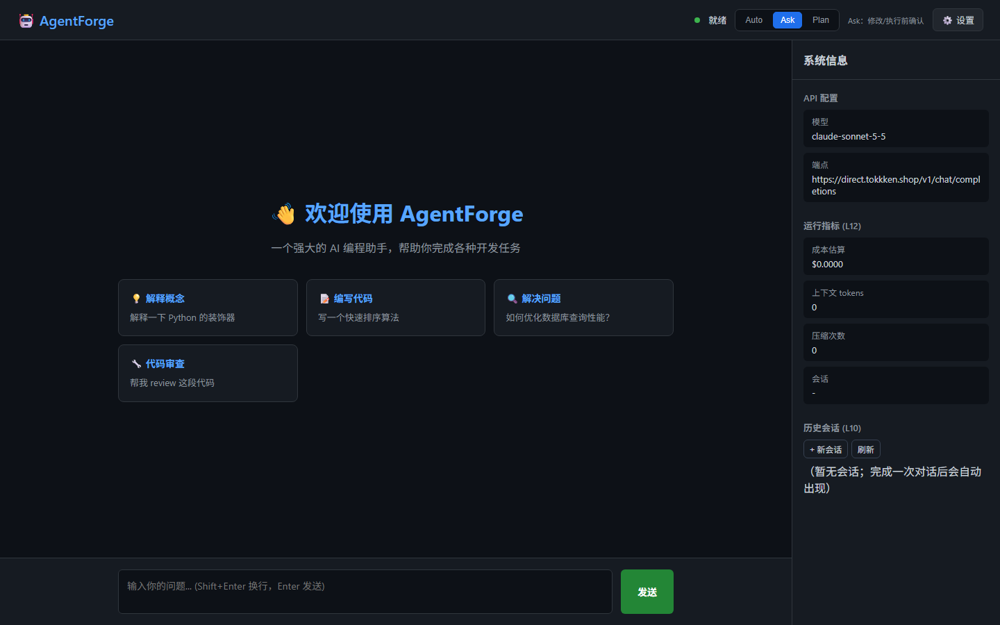

# AgentForge - Coding Agent Harness (L1-L12)

> **状态**: ✅ L1-L12 全阶段功能已实现并集成到 Web 主程序，编译、自检、端到端验证通过
> **主程序**: `bin/Release/agentforge_web.exe` ｜ **控制台版**: `bin/Release/agentforge_v2.exe`
> **验证记录**: [docs/VERIFICATION.md](docs/VERIFICATION.md) ｜ **交接**: [HANDOVER.md](HANDOVER.md)

一个面向代码仓库的 C++20 Coding Agent Harness：分层上下文、工具管线、六道闸门、
Windows 沙箱、五级压缩、tree-sitter 代码地图、JSONL 会话、并行子代理、Trace 仪表盘，
自带 Web UI 与多提供商接入。



---

## 🚀 快速开始

```bat
cd AgentForge
quick_build.bat
run_server.bat
```

浏览器打开 <http://127.0.0.1:8080/>。首次使用可在 `/setup.html` 配置 API（或右上角设置）。

### 三种运行模式（右上角切换）

| 模式 | 行为 |
|------|------|
| **Auto** | 自主执行；Write/Edit/Bash 不再逐步弹窗，但显式 deny 规则仍优先 |
| **Ask** | 默认；修改/执行前弹出权限确认 |
| **Plan** | 只读调研；只加载 Read/Glob/Grep，不写文件、不执行命令 |

### 历史会话

右侧「历史会话」会列出已保存会话；点击任意一条即可加载消息并继续对话。
「+ 新会话」开始新会话，「刷新」重新拉取列表。会话保存在 `conversations/<session_id>/`，每次对话一个目录。

每次对话目录包含：

```
conversations/<session_id>/
├─ README.md                 对话摘要
├─ meta.json                 标题/时间/消息数/token
├─ events.jsonl              事件流
├─ snapshot.json             完整消息快照
├─ checkpoints/              Write/Edit 前文件备份
├─ trace.jsonl               L12 Trace
├─ artifacts/manifest.jsonl  本次对话改动的文件路径
└─ workspace/                Agent 默认写/改/执行目录
```

### 工作区

⚙️ 设置 → **工作区路径**：

- 留空：当前对话的 `conversations/<日期_主题>/workspace/`
- 填写：使用指定目录，例如项目根目录
- `Write` / `Edit` / `Bash` 只能写该目录；绝对路径越界会被拒绝
- `Read` / `Glob` / `Grep` 仍可读取项目源码

对话目录名格式：`YYYYMMDD_HHMMSS_<主题>`，主题取首条用户消息并做非法字符清理。

### 设置里切换模型

⚙️ 设置 → 填 endpoint/key → 点 **🔍 检测模型**：
后端会请求 `/v1/models`（OpenAI 兼容）或 `/v1/models`（Anthropic），
下拉选择后保存即可，不需要重启。检测只读取、不落盘；保存时才写 `config.json`。

### 运行限制（Web 设置）

⚙️ 设置 → **运行限制** 可直接改，点保存立即生效：

- 最大步数
- 累计 Token 预算（`max_total_tokens`，0 = 不限）
- 上下文窗口 tokens
- 单次输出 `max_tokens`
- 时间上限 / 历史消息上限 / 重复调用 / 连续错误
- 自动压缩、LLM 摘要、自动记忆

> **所有数字限制都支持 0 = 不限**（`max_tokens=0` 表示交给模型默认/最大输出）。
> 简单任务也报“超出 token 预算”通常是 **累计预算** 太小（旧默认 100000），不是上下文超长。
> 新默认是 `max_total_tokens=500000`，可在设置里随时调大或设为 0。

前置条件：

- CMake ≥ 3.15
- Visual Studio 2022/2026（C++ 桌面工作负载，Build Tools 也可以）
- 首次编译会编译内置 tree-sitter C 源码（约 25 MB，1-3 分钟）

产物：

| 文件 | 用途 |
|------|------|
| `agentforge_web.exe` | Web UI + HTTP API（主要入口） |
| `agentforge_v2.exe` | 控制台版 + 仪表盘/自检（`--cost/--context/--regress/--selftest`） |
| `agentforge.exe` | 最小控制台 Demo |

---

## ✅ L1-L12 功能对照

| 阶段 | 已实现能力 | 关键代码 |
|------|-----------|----------|
| **L1** 需求与总体设计 | 13 模块分层、W1-W4 机制、端口/适配器架构、契约不变式 | `docs/L1-L12_MATRIX.md`、`types.hpp` |
| **L2** 模块契约 | `IModelProvider`/`IHttpTransport`/`IToolPlugin` 风格 `ToolRegistry`/`ISandbox`/`IPermissionGate`/`IUIPort`/`ILoopTracer` | `include/*.hpp` |
| **L3** 能对话 | OpenAI 兼容 + Anthropic 双协议、SSE 流式、重试/超时、UTF-8 | `multi_provider.cpp`、`simple_http_transport.cpp` |
| **L4** 能读 | 工具定义下发、Read/Glob/Grep、**Schema 校验/权限门/文本消毒/大结果落盘** | `tool_registry.hpp`、`core_tools.cpp` |
| **L5** 能改能自主循环 | AgentLoop、Write/Edit/Bash、上下文分层组装、消息合法性守卫 | `agent_loop.hpp`、`context_manager.hpp` |
| **L6** 能刹车 | 六道闸门（步数/预算/墙钟/连续错误/重复/中断）、`/api/cancel`、Job Object 沙箱、权限弹窗+持久化 | `agent_loop.hpp`、`sandbox_win.cpp`、`permission_gate.hpp` |
| **L7** 有记忆 | 五级压缩（L1-L4 + 大结果 L0）、LLM/抽取式摘要、token 预算、Anthropic 流式 | `context_manager.hpp`、`multi_provider.cpp` |
| **L8** 有地图 | **tree-sitter** 符号抽取 + 词法兜底、include 依赖图、PageRank、活动文件偏置、地图注入、混合检索 | `thirdparty/tree-sitter`、`repo_index.hpp`、`symbol_extract.cpp` |
| **L9** 有面目 | Web UI：SSE 流式、工具卡片、**Auto/Ask/Plan 三种模式**、权限弹窗、停止按钮、会话侧栏（加载/继续）、指标面板 | `web/index.html` |
| **L10** 能存档 | 每会话 JSON/JSONL、消息回放、文件检查点/恢复、`/api/sessions`、三层记忆（AGENTS/CLAUDE/MEMORY） | `session_store.hpp` |
| **L11** 会分身 | `Task` 工具、并行只读子代理、上下文/工具/UI 隔离、深度限制、成本汇总 | `subagent.hpp` |
| **L12** 有仪表盘 | JsonlTracer span/event、环形缓冲、`/api/metrics`、`/api/trace`、Web 指标面板、`--cost/--context/--regress` | `trace.hpp`、`main_v2.cpp` |

> 与课程参考实现的差异：L9 采用 **Web UI** 而不是 FTXUI TUI（功能等价且更适合演示）；
> 权限门/会话/仪表盘均已接入 Web 主流程，不是只有类/命令的骨架。

---

## 🏗️ 架构

```
web/index.html ──SSE──> main_web_simple.cpp
                          │
        ┌─────────────────┼──────────────────┐
        ▼                 ▼                  ▼
  ContextManager     AgentLoop          JsonlTracer
  (L0-L6 分层/压缩)   (六道闸门)         (/api/metrics)
        │                 │
        │        ┌────────┴────────┐
        ▼        ▼                 ▼
    RepoIndex  ToolRegistry     PermissionGate
  (tree-sitter) (校验/权限/落盘)  (.af-permissions.json)
        │        │
        │        ├── Read/Write/Edit/Glob/Grep
        │        ├── Bash → WindowsSandbox(Job Object)
        │        └── Task → SubagentRunner(并行只读)
        ▼
  SessionStore / MemoryStore
```

主要文件：

- `src/main_web_simple.cpp` — Web 入口 + 全部 API
- `src/main_v2.cpp` — 控制台版 + `--cost/--context/--regress/--selftest`
- `include/agent_loop.hpp` — 循环 + 六道闸门 + 上下文/权限/追踪接线
- `include/context_manager.hpp` — 分层上下文 + 五级压缩
- `include/tool_registry.hpp` — 工具五步管线
- `include/repo_index.hpp` — 代码地图 + PageRank + 检索
- `include/session_store.hpp` — 会话/检查点/三层记忆
- `include/subagent.hpp` — Task 子代理
- `include/trace.hpp` — L12 追踪
- `thirdparty/tree-sitter/` — tree-sitter 0.25 + C++ 文法

---

## 🔌 HTTP API

| 方法 | 路径 | 说明 |
|------|------|------|
| GET | `/api/health` | 健康检查 + 特性列表 |
| GET/POST | `/api/config` | 读取（Key 脱敏）/更新配置 |
| GET | `/api/tools` | 工具（含 Task）与 Schema |
| POST | `/api/models` | 探测 endpoint 的 `/models` 列表（不落盘） |
| GET/POST | `/api/permissions` | 权限规则（可 reset） |
| POST | `/api/permission` | 弹窗回传：allow_once/always_allow/deny_once/always_deny |
| POST | `/api/cancel` | 取消运行中的请求 |
| GET/POST | `/api/sessions` | 会话列表/新建 |
| GET | `/api/sessions/{id}` | 会话消息 |
| GET | `/api/sessions/{id}/checkpoints` | 文件检查点 |
| POST | `/api/sessions/{id}/restore` | 回滚检查点 |
| GET/POST | `/api/memory` | 长期记忆 |
| POST | `/api/index` | 重建代码地图 |
| GET | `/api/repo-map` | 代码地图文本 |
| GET | `/api/metrics` | 成本/上下文/压缩/会话指标 |
| GET | `/api/trace` | 最近一次 Trace |
| POST | `/api/execute-stream` | SSE Agent Loop（Web UI 使用） |
| POST | `/api/execute` | 单轮非流式 |

SSE 事件：`start`、`stage`、`chunk`、`tool_call`、`tool_result`、
`permission_request`、`done`、`error`。

---

## ⚙️ 配置

`config.json`（模板见 `config.example.json`）：

```json
{
  "api": { "provider": "custom", "endpoint": "https://...", "key": "sk-...",
           "model": "your-model", "temperature": 0.7, "max_tokens": 4096 },
  "agent": {
    "max_steps": 20, "time_limit_seconds": 300,
    "max_context_tokens": 100000, "max_total_tokens": 500000,
    "max_history_messages": 40,
    "max_repeat_calls": 3, "max_consecutive_errors": 3,
    "compaction": true, "llm_summary": false,
    "auto_memory": true, "max_subagent_depth": 2
  },
  "tools": {
    "sandbox": true, "work_dir": "",
    "dump_dir": ".af-dump", "persist_threshold": 20000,
    "permission_mode": "ask",
    "workspace_root": ""
  },
  "retrieval": { "enabled": true, "top_k": 5 }
}
```

- `permission_mode`: `ask`（弹窗）/`allow_all`/`deny_all`；显式 deny 规则始终优先。
- `tools.sandbox=true` 时 Bash 在 Job Object 沙箱执行（工作目录/超时/进程数/内存上限）。
- `llm_summary=false` 使用抽取式摘要（零额外成本）；`true` 调用模型摘要。
- 工具路径支持 `%USERPROFILE%`、`%TEMP%`、`~`。

---

## 🧪 测试

```powershell
# 编译后自检：工具校验/权限/压缩/tree-sitter/会话/记忆/追踪（15 项）
bin\Release\agentforge_v2.exe --selftest

# 服务冒烟：health/静态页/tools/config/permissions/sessions/memory/metrics/repo-map
powershell -ExecutionPolicy Bypass -File tools\smoke_test.ps1

# 仪表盘
bin\Release\agentforge_v2.exe --cost conversations
bin\Release\agentforge_v2.exe --context
bin\Release\agentforge_v2.exe --regress <file.jsonl>
```

离线端到端（无需外网）：

```powershell
python tools\mock_llm_server.py 18081
bin\Release\agentforge_web.exe --config config.test.json --port 18080
```

Mock 覆盖：流式、Read/Write/Bash/Grep、权限弹窗（config.perm）、Task、压缩、取消、检查点。

---

## 📁 目录

```
AgentForge/
├─ src/            main_web_simple.cpp / main_v2.cpp / core_tools.cpp /
│                  multi_provider.cpp / simple_http_transport.cpp /
│                  sandbox_win.cpp / symbol_extract.cpp / ui_impl.cpp / mock_provider.cpp
├─ include/        types / model_provider / tool_registry / agent_loop /
│                  context_manager / repo_index / session_store / subagent /
│                  trace / permission_gate / sse_ui_adapter / win_utf8 ...
├─ thirdparty/tree-sitter/   tree-sitter 0.25 + cpp grammar
├─ web/            index.html / setup.html
├─ tools/          mock_llm_server.py / smoke_test.ps1 / check_web_ui.py / fix_integrity.bat
├─ docs/           L1-L12_MATRIX / VERIFICATION / CONFIGURATION_GUIDE / QUICK_START / images
├─ bin/Release/    3 个 exe
└─ CMakeLists.txt / build_and_test.ps1 / quick_build.bat / run_server.bat
```

> 早期重复实现与过时文档已删除；`src/` 中仍有一个未参与构建的
> `wininet_http_transport.cpp`（被陈旧高权限编译进程锁定，重启后可删）。

## 📚 文档

- [HANDOVER.md](HANDOVER.md) — 交接与状态
- [docs/L1-L12_MATRIX.md](docs/L1-L12_MATRIX.md) — 逐阶段实现矩阵与验收
- [docs/VERIFICATION.md](docs/VERIFICATION.md) — 验证记录
- [docs/CONFIGURATION_GUIDE.md](docs/CONFIGURATION_GUIDE.md) — 配置详解
- [START_HERE.md](START_HERE.md) — 3 步启动
- [CHANGELOG.md](CHANGELOG.md) — 版本变更
